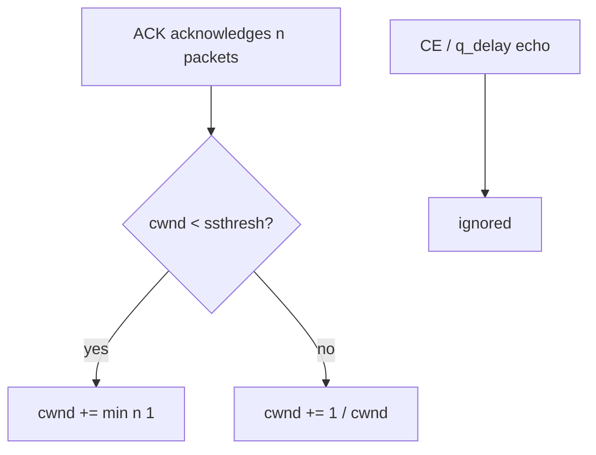
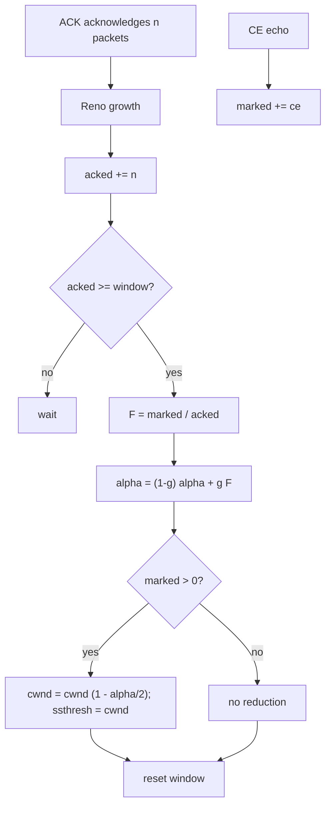
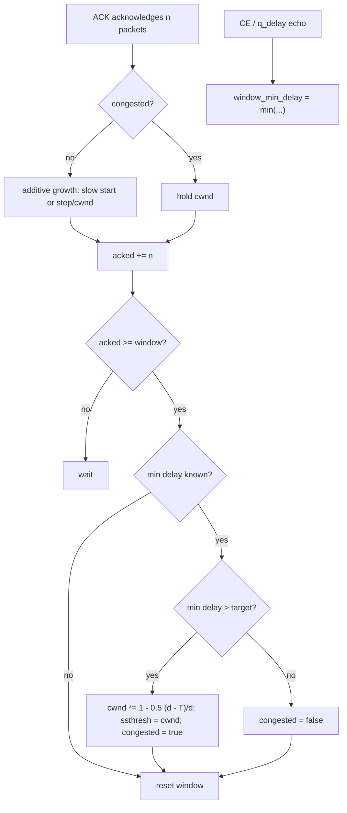

# Phase 7 controller modes

Sender-side congestion controllers selected with `--cc-mode {reno,dctcp,delay}`.
All three share the Reno loss response (RFC 5681: fast retransmit halves,
timeout drops to one packet) and the controller interface
(`on_ack`, `on_loss`, `on_timeout`, `on_feedback`).

## Shared definitions

- **Window of data.** `AckWindow` closes once `cwnd` packets have been acknowledged
  since it opened. The interface carries no sequence numbers, so this stands in
  for one RTT.
- **Feedback.** The sender calls `on_feedback(ce_new, q_delay)` for every accepted
  ACK. `ce_new` is the CE packets newly echoed; `q_delay` is the echoed queueing
  delay in seconds.
- **Order within one ACK.** Growth is applied first, then the window-close
  decision, so the packet that closes a window counts toward that window.

## Mode A: `reno` (loss-only)

```
on_ack(n):
    if cwnd < ssthresh: cwnd += min(n, 1)            # slow start
    else:               cwnd += 1 / cwnd              # congestion avoidance
on_feedback(ce, q):  ignored
on_loss(fs):         ssthresh = max(fs/2, 2); cwnd = ssthresh
on_timeout(fs, seg): if first timeout of seg: ssthresh = max(fs/2, 2); cwnd = 1
```



## Mode B: `dctcp` (ECN fraction, alpha)

Parameter: `g` in (0, 1], default 1/4 (chosen by the sweep in section 4).

```
on_feedback(ce, q):  marked += ce
on_ack(n):
    Reno growth (as Mode A)
    acked += n
    if acked >= window_target:            # one window of data
        F     = min(1, marked / acked)
        alpha = (1 - g) * alpha + g * F
        if marked > 0:
            cwnd = max(1, cwnd * (1 - alpha / 2))
            ssthresh = cwnd                # leave slow start
        marked = 0; acked = 0; window_target = cwnd
on_loss / on_timeout: Reno response
```



## Mode C: `delay` (queue-delay target)

Parameters: `target_seconds` (default 5 ms, inside the guide's 5-10 ms range),
`increase_step` (default 1 packet per RTT). The proportional gain is 0.5.

```
on_feedback(ce, q):  window_min_delay = min(window_min_delay, q)
on_ack(n):
    if not congested:
        if cwnd < ssthresh: cwnd += min(n, 1)            # slow start
        else:               cwnd += increase_step / cwnd   # additive increase
    acked += n
    if acked >= window_target:
        if window_min_delay is known:
            congested = window_min_delay > target
            if congested:
                excess = (d - target) / d
                cwnd = max(1, cwnd * (1 - 0.5 * excess))
                ssthresh = cwnd
        reset window
on_loss / on_timeout: Reno response
```



## Parameter selection

Single scenario S1 (relay, 5 Mbps, 20 ms per link, 5 MB, RED in mark mode, 200-packet
queue). Rule fixed before the matrix: the lowest p95 queue delay among settings
with goodput at least 95% of Mode A. Results are in `results/phase7/tuning/`.

| Setting | Mean delay (ms) | p95 delay (ms) | Goodput (Mbps) |
|---|---:|---:|---:|
| Mode A (reno) | 34.1 | 77.7 | 4.104 |
| dctcp g = 1/16 | 32.0 | 63.9 | 4.117 |
| dctcp g = 1/4 (chosen) | 29.7 | 56.1 | 4.103 |
| delay target 10 ms, step 1 | 5.7 | 14.7 | 4.106 |
| delay target 10 ms, step 2 | 6.7 | 18.0 | 4.246 |
| delay target 5 ms, step 1 (chosen) | 2.0 | 9.8 | 3.942 |
| delay target 5 ms, step 2 | 3.1 | 13.1 | 3.965 |

Both sweeps are small (two Mode B values, four Mode C values) and single-run.
